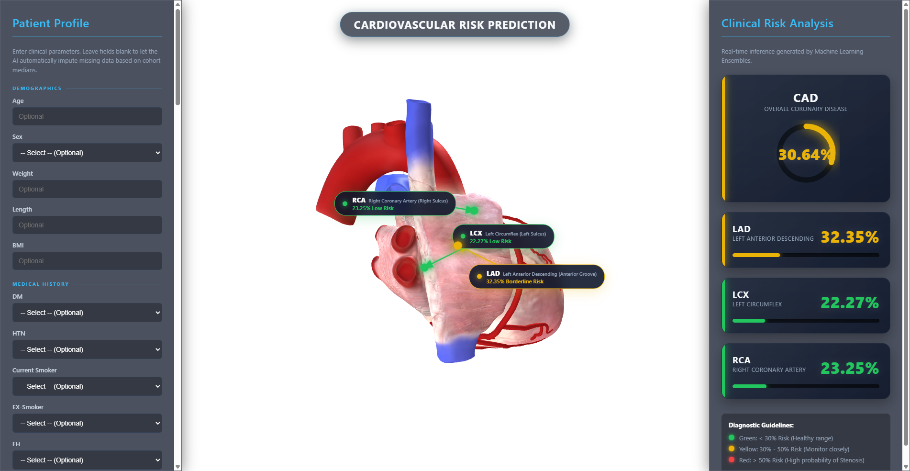
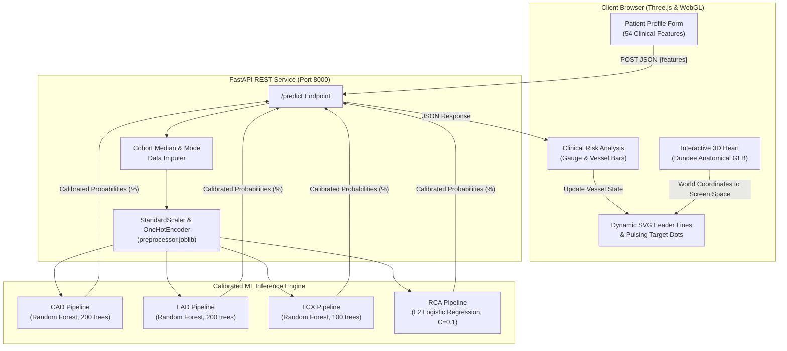

<div align="center">

# CardioRisk: 3D Cardiovascular Risk Intelligence Platform
### Interactive 3D Cardiac Vasculature Mapping & Calibrated Multi-Target Coronary Artery Disease Risk Prediction

[](https://www.python.org/)
[](https://fastapi.tiangolo.com/)
[](https://threejs.org/)
[](https://scikit-learn.org/)
[](https://www.khronos.org/webgl/)
[](https://opensource.org/licenses/MIT)

<p align="center">
  <b>Translating routine clinical, laboratory, ECG, and echocardiographic parameters into localized, vessel-specific 3D spatial risk inferences on a realistic anatomical human heart.</b>
</p>

</div>

---

## Visual Dashboard Preview

<div align="center">
  
  <p><i>Real-time inference visualization: Dual glassmorphism clinical panels, dynamic SVG leader lines, pulsating target dots, and the 3D anatomical heart model.</i></p>
</div>

---

## Executive Overview & Clinical Motivation

**Coronary Artery Disease (CAD)** remains the leading cause of global cardiovascular mortality. Conventional statistical risk assessment calculators (such as the Framingham Risk Score or pooled ASCVD equations) possess two major clinical limitations:
1. **Lack of Anatomical Specificity:** They output an abstract 10-year percentage of an adverse coronary event, failing to pinpoint which specific arterial branch is compromised.
2. **Static 2D Presentation:** Risk scores are typically rendered as raw numerical tables, creating a cognitive barrier for patient education and multidisciplinary surgical planning.

**CardioRisk** bridges this gap. By utilizing multi-target machine learning ensembles calibrated with Platt Sigmoid scaling, the platform predicts the probability of stenosis for **overall CAD** as well as the **three primary coronary arteries**:
* **LAD (Left Anterior Descending):** The "widow-maker" artery responsible for perfusing the anterior left ventricular wall and apex.
* **LCX (Left Circumflex):** Supplies the lateral and posterior aspects of the left ventricle.
* **RCA (Right Coronary Artery):** Supplies the right atrium, right ventricle, and the sinoatrial/atrioventricular nodal conduction system.

Predictions are then rendered onto an **anatomically accurate 3D heart model** with spatial pointers dynamically locked to the true coronary sulci and grooves.

---

## System Architecture



---

## 3D Anatomical Engine & Vasculature Mapping

The 3D environment is powered by **Three.js (r128)**, utilizing an anatomical asset sculpted by medical illustrator **Hannah Newey** for the **University of Dundee** (Centre for Anatomy and Human Identification / CAHID).

### 1. True Anatomical Groove Localization
Rather than approximating vessel positions, the platform attaches `THREE.Object3D` anchor nodes into the model's inner mesh hierarchy (`SubTool-0-12100944.OBJ`), matching original clinical annotation pins:

| Artery | Anatomical Landmark | Mesh Local Coordinates | World Coordinates $(X, Y, Z)$ |
| :--- | :--- | :---: | :---: |
| **LAD** | **Anterior Interventricular Groove** (descending toward apex) | `(0.4023, -0.2475, 0.0036)` | `(+1.127, -0.211, +0.369)` |
| **LCX** | **Left Atrioventricular Sulcus** (lateral margin of left ventricle) | `(0.4111, -0.0794, -0.1043)` | `(+1.165, -0.674, -0.352)` |
| **RCA** | **Right Coronary Sulcus** (between right atrium and ventricle) | `(0.0615, -0.2237, 0.1614)` | `(-0.335, +0.466, +0.267)` |

### 2. Coordinate Transformation Pipeline
Sketchfab GLTF exports embed an internal $-90^\circ$ rotation matrix on `Node 0 (Sketchfab_model)`. Parenting the anchors within the inner mesh hierarchy ensures that Three.js automatically computes:
$$\mathbf{P}_{\text{world}} = \mathbf{M}_{\text{scene}} \times \mathbf{M}_{\text{root}} \times \mathbf{M}_{\text{mesh}} \times \mathbf{p}_{\text{local}}$$
When projected to the camera view plane:
$$\mathbf{P}_{\text{screen}} = \text{project}(\mathbf{P}_{\text{world}}, \mathbf{K}_{\text{camera}})$$
This locks the SVG leader lines and pulsing target dots directly onto the physical coronary vessels regardless of user orbit, pan, or zoom interactions.

### 3. Anatomical Texture Integrity
Unlike simplistic vertex-coloring approaches that cause venous networks and capillaries to turn an artificial yellow or red, CardioRisk **preserves 100% of the original anatomical textures, fat pads, muscle striations, and valves**. Clinical risk states are communicated strictly through:
* Neon vector leader lines with dynamic drop-shadow filters.
* Pulsing target rings directly over the coronary branches.
* Color-coded floating cards and risk metrics.

---

## Machine Learning & Statistical Validation

### 1. Benchmark Dataset
* **Cohort:** Z-Alizadeh Sani Coronary Artery Disease Dataset (Tehran Heart Center).
* **Sample Size:** $303$ patients evaluated via catheter-based coronary angiography (gold standard).
* **Dimensionality:** $54$ clinical parameters categorized into Demographics, Medical History, Vitals, Symptoms, Electrocardiography (ECG), Laboratory Biomarkers, and Echocardiography.

### 2. Multi-Target Evaluation Benchmark (Hold-Out Test Set $N=61$)

All models were selected via `RandomizedSearchCV` across a 5-fold Stratified Cross-Validation scheme and calibrated via Platt Sigmoid scaling (`CalibratedClassifierCV`):

| Target | Model Architecture | 5-Fold CV AUC | Test ROC-AUC | Test Accuracy | Precision | Recall | F1-Score |
| :--- | :--- | :---: | :---: | :---: | :---: | :---: | :---: |
| **CAD (Overall)** | Random Forest ($200$ trees, depth $15$) | **$0.9305$** | **$0.8760$** | **$88.52\%$** | $87.50\%$ | $97.67\%$ | **$0.9231$** |
| **LAD** | Random Forest ($200$ trees, depth $10$, leaf $\ge 4$) | **$0.8519$** | **$0.7985$** | **$72.13\%$** | $70.73\%$ | $85.29\%$ | **$0.7733$** |
| **LCX** | Random Forest ($100$ trees, depth $10$, leaf $\ge 2$) | **$0.7647$** | **$0.6989$** | **$72.13\%$** | $76.47\%$ | $50.00\%$ | **$0.6047$** |
| **RCA** | Logistic Regression (L2 Penalty, $C=0.1$) | **$0.7299$** | **$0.7171$** | **$63.93\%$** | $41.67\%$ | $25.00\%$ | **$0.3125$** |

### 3. Overfitting Analysis & Variance Controls
* **$N:P$ Ratio Management:** With $242$ training rows against $54$ variables, unconstrained algorithms risk memorizing noise.
* **Regularization Safeguards:**
  * **LAD:** Regularized with `min_samples_leaf = 4` and `max_depth = 10`, ensuring leaves aggregate multiple patient profiles.
  * **RCA:** L2-regularized Logistic Regression ($C=0.1$, strong ridge penalty) prevented high variance, yielding near-zero gap between CV AUC ($0.7299$) and Test AUC ($0.7171$).
  * **Ensemble De-correlation:** Random Forests utilized `max_features = 'sqrt'`, evaluating only $\approx 7$ random features per split.
* **Zero Data Leakage:** Preprocessing transformations (median imputation and standard scaling) were fitted strictly on `X_train` before transforming `X_test`.

### 4. Key Predictive Biomarkers (SHAP Analysis)
Clinical interpretability via TreeSHAP identified the dominant predictors across the cohort:
1. **Typical Chest Pain & Nonanginal Pain:** Highest directional impact on acute ischemic probability.
2. **Region RWMA (Regional Wall Motion Abnormality):** Key echocardiographic indicator of localized myocardial hypoperfusion.
3. **EF-TTE (Ejection Fraction):** Inverse correlation with multi-vessel disease severity.
4. **Age & Blood Pressure (BP):** Primary systemic demographic baseline contributors.
5. **FBS (Fasting Blood Sugar) & Dyslipidemia (TG, LDL, HDL):** Long-term metabolic acceleration of atherosclerotic plaque accumulation.

---

## Clinical Triage Guidelines & Color Standards

The platform follows clinical risk stratification standards aligned with ACC/AHA diagnostic pathways:

```
┌─────────────────────────────────────────────────────────────────────────────┐
│ RISK THRESHOLD     SEVERITY LEVEL             RECOMMENDED CLINICAL ACTION   │
├─────────────────────────────────────────────────────────────────────────────┤
│ < 30% (Green)      Healthy Baseline / Low     Lifestyle counseling & annual │
│                                               preventive monitoring.        │
│                                                                             │
│ 30% - 50% (Yellow) Borderline / Moderate      Closer surveillance, non-     │
│                                               invasive stress ECG / CCTA.   │
│                                                                             │
│ > 50% (Red)        High Stenosis Risk         Urgent cardiology referral &  │
│                                               Coronary Angiography (ICA).   │
└─────────────────────────────────────────────────────────────────────────────┘
```

---

## Repository Directory Hierarchy

```text
CardioRisk/
├── assets/
│   └── dashboard_preview.png       # Platform visual preview for documentation
│
├── backend/
│   ├── main.py                     # FastAPI server with CORS & Pydantic request models
│   └── requirements.txt            # Python dependencies (FastAPI, uvicorn, scikit-learn)
│
├── frontend/
│   ├── index.html                  # Main WebGL dashboard, Three.js scene & UI panels
│   └── human_heart.glb             # 98 MB Dundee anatomical 3D cardiac GLTF model
│
├── cardiorisk_outputs/
│   ├── models/                     # Serialized pipelines & metric artifacts
│   │   ├── CAD_pipeline.joblib     # Calibrated CAD Random Forest pipeline
│   │   ├── LAD_pipeline.joblib     # Calibrated LAD Random Forest pipeline
│   │   ├── LCX_pipeline.joblib     # Calibrated LCX Random Forest pipeline
│   │   ├── RCA_pipeline.joblib     # Calibrated RCA Logistic Regression pipeline
│   │   ├── metrics_summary.csv     # Quantitative validation metrics table
│   │   ├── *_roc.png               # ROC curve plots for each vessel
│   │   ├── *_confusion.png         # Confusion matrix plots
│   │   └── *_calibration.png       # Reliability calibration curves
│   └── artifacts/                  # Preprocessing artifacts & imputation schema
│       ├── preprocessor.joblib     # ColumnTransformer (impute + scale + OHE)
│       ├── raw_feature_schema.json # JSON schema defining types and boundaries
│       └── preprocessing_report.md # Data profiling summary report
│
├── Dataset/
│   └── extention of Z-Alizadeh sani dataset.xlsx  # Benchmark clinical cohort data
│
├── preprocessing.py                # Preprocessing pipeline, feature grouping & clean splits
├── train_models.py                 # Multi-target hyperparameter grid search & calibration
├── shap_explainability.py          # SHAP global and local feature importance analysis
├── .gitignore                      # Git exclusion rules (ignores caches, scratch, and archives)
└── README.md                       # Complete platform documentation
```

---

## Getting Started

### Prerequisites
* **Python:** Version `3.10` or higher
* **Web Browser:** Google Chrome, Microsoft Edge, Firefox, or Safari with WebGL enabled

### 1. Clone the Repository
```bash
git clone https://github.com/YOUR_USERNAME/CardioRisk.git
cd CardioRisk
```

### 2. Launch the Backend API
```bash
# Enter backend directory
cd backend

# Create and activate virtual environment
python -m venv venv

# Windows:
venv\Scripts\activate
# macOS/Linux:
source venv/bin/activate

# Install dependencies
pip install -r requirements.txt

# Start FastAPI server on port 8000
uvicorn main:app --reload --port 8000
```
Interactive Swagger UI documentation is accessible at **`http://127.0.0.1:8000/docs`**.

### 3. Launch the 3D Frontend
Open a new terminal window:
```bash
# Enter frontend directory
cd frontend

# Serve static assets via Python HTTP server
python -m http.server 8080
```
Navigate to **`http://localhost:8080`** in your browser.

---

## REST API Specification

### Endpoint: Analyze Patient Risk
* **URL:** `/predict`
* **Method:** `POST`
* **Content-Type:** `application/json`

#### Sample Request Payload:
```json
{
  "features": {
    "Age": 62,
    "Sex": 1.0,
    "Weight": 82,
    "Length": 174,
    "BMI": 27.1,
    "DM": 1.0,
    "HTN": 1.0,
    "Current Smoker": 1.0,
    "BP": 145,
    "PR": 78,
    "Typical Chest Pain": 1.0,
    "Function Class": 2.0,
    "EF-TTE": 42,
    "Region RWMA": 2.0,
    "FBS": 138,
    "CR": 1.1,
    "TG": 180,
    "LDL": 145,
    "HDL": 34
  }
}
```
*(Any clinical parameters left unspecified are automatically imputed by the pipeline using verified cohort medians.)*

#### Sample Response:
```json
{
  "status": "success",
  "risk_scores": {
    "CAD": 68.42,
    "LAD": 61.15,
    "LCX": 38.20,
    "RCA": 29.80
  },
  "message": "Predictions generated successfully."
}
```

---

## Production Deployment (Google Cloud Run)

To deploy CardioRisk as a single containerized service:

```dockerfile
FROM python:3.11-slim
WORKDIR /app

COPY backend/requirements.txt requirements.txt
RUN pip install --no-cache-dir -r requirements.txt

COPY backend/ ./backend/
COPY cardiorisk_outputs/models/ ./cardiorisk_outputs/models/
COPY frontend/ ./frontend/

WORKDIR /app/backend
EXPOSE 8080
CMD ["uvicorn", "main:app", "--host", "0.0.0.0", "--port", "8080"]
```

Deploy using the Google Cloud CLI:
```bash
gcloud run deploy cardiorisk \
  --source . \
  --region us-central1 \
  --allow-unauthenticated \
  --memory 2Gi
```

---

## Citations & Acknowledgments

* **3D Heart Vasculature Asset:** Sculpted and curated by medical illustrator **Hannah Newey** for the **University of Dundee** (Centre for Anatomy and Human Identification / CAHID).
* **Clinical Study & Dataset:** *Z-Alizadeh Sani Dataset* (Alizadehsani et al.), Tehran Heart Center, Iran; archived on the UC Irvine Machine Learning Repository.
* **Core Technologies:** [Three.js](https://threejs.org/), [FastAPI](https://fastapi.tiangolo.com/), [scikit-learn](https://scikit-learn.org/), [Uvicorn](https://www.uvicorn.org/).

---

## License

This project is licensed under the [MIT License](LICENSE).
